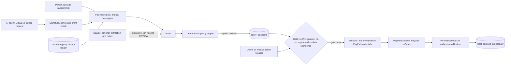

# Architecture

A modular monolith: one Node process, one SQLite database, and a React UI served by the same server.

## Boundaries
- `server/src/executor/paypal.ts` is the only module that reads PayPal credentials. Its payment methods require a gate pass, a frozen object registered in a private `WeakSet` by `gate.ts`. A test fails the build if `ai/`, `ingest/`, `evidence/` or `agents/` import the executor.
- `server/src/policy/engine.ts` is pure: no I/O, no clock, no model. Its input is typed facts; its output is a decision plus reasons, each marked as approvable or not. Only `REVIEW` reasons can be satisfied by an approval.
- `server/src/ai/model.ts` has no tools. Its output schemas contain no verdict or approval field. Model-only field reads trigger `REVIEW`, and model/parser disagreements trigger `HOLD`.

## Transaction Trust Envelope
`core/tte.ts` canonicalizes workspace, revision, principal, agent, authorization ID and version, payee, destination fingerprint, invoice ID and fingerprint, integer minor-unit amount, currency, category, source artifacts and policy version, then hashes them with SHA-256. Decisions and approvals bind to this fingerprint. A separate business `payment_key` (vendor, invoice fingerprint, amount, currency) has a partial unique index, so the same invoice cannot be paid through two requests.

## State machine
`RECEIVED → EXTRACTING → INVESTIGATING → EVALUATED → READY_FOR_CONFIRMATION | AWAITING_REVIEW | ON_HOLD | DENIED`, then `EXECUTING → PAYMENT_PENDING → COMPLETED | FAILED`. A material change increments the revision, voids approvals, supersedes decisions and re-evaluates. A provider timeout records `UNKNOWN`, never success.

## Data
`server/src/db/schema.sql` defines the tables listed in the plan. Money is stored as integer minor units. Policy versions and audit events are protected by triggers that block updates and deletes. The schema is applied idempotently at boot.
